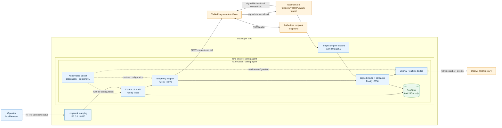
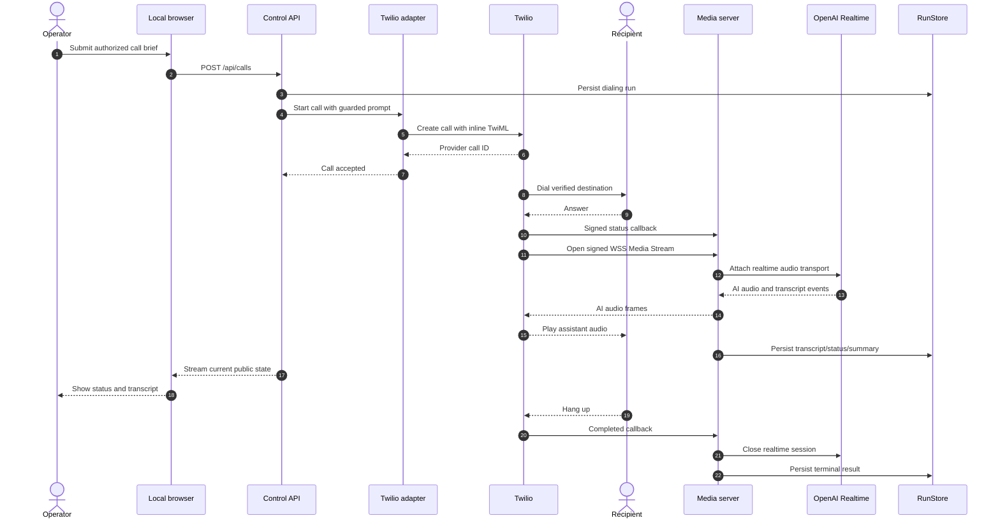

# Calling Agent Architecture

The application is a browser-controlled outbound voice agent isolated inside a
local kind cluster. Twilio provides the telephone leg, while OpenAI Realtime
provides the conversational audio leg. A temporary public tunnel exposes only
the media/callback server required by Twilio.

## Component architecture

## Successful call flow

## Trust boundaries and controls

| Boundary | Control |
| --- | --- |
| Browser to control API | Permanently exposed only on Mac loopback |
| Provider to media server | Twilio request-signature validation or Telnyx Ed25519 validation |
| Media session lookup | Cryptographically random per-call URL token |
| Pod execution | Application container uses non-root UID/GID `10001`, runtime-default seccomp, dropped capabilities, and a read-only root filesystem. A constrained root init container has only `CHOWN`/`FOWNER` to prepare the PVC. |
| Credentials | Kubernetes Secret references; never returned by the UI or stored in run JSON |
| Persistence | Text artifacts only on a dedicated `128Mi` PVC; no audio recording |
| Public ingress | Temporary and limited to the media server; remove by stopping the tunnel |
| Call authority | Strict JSON schema, explicit allowed actions/disclosures, one active call, bounded duration |

## Runtime separation

The control and media listeners run in the same pod but on different ports and
with different exposure rules:

- Port `8080` serves the local UI, call-control API, state stream, downloads,
  and readiness endpoint.
- Port `5050` accepts provider media WebSockets, signed lifecycle callbacks,
  and a minimal health endpoint.
- The public tunnel targets only port `5050`; it does not expose the browser
  control panel.

This split keeps dialing authority local while giving the telephony provider
the smallest public surface required for realtime media.
